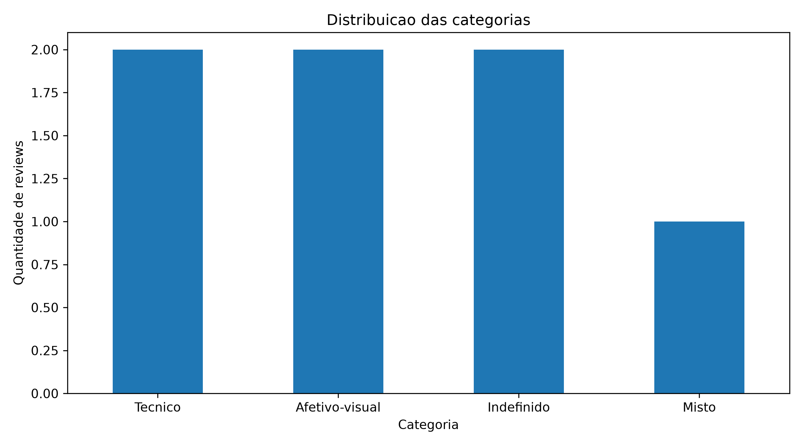

# Triagem de reviews de jogos digitais com IA simbólica

**TCC — Ciência da Computação — UDF — 2026/2**
Autora: Melissa Aragão Leite

Sistema especialista baseado em regras que classifica reviews de jogos digitais em
**Técnico**, **Afetivo-visual**, **Misto** ou **Indefinido**. O objetivo é separar críticas
a falhas técnicas de comentários motivados pela rejeição à aparência de personagens
femininas (*review bombing*).

Toda classificação é rastreável: o sistema registra quais indicadores encontrou, os
escores de cada grupo, a regra aplicada e a confiança. Não há aprendizado de máquina
envolvido (justificativa em [docs/decisao_ia.md](docs/decisao_ia.md)).

---

## Como funciona

```
CSV de entrada → preparação → base de conhecimento → escores → regras → relatórios
```

1. **Entrada** — `data/reviews_entrada.csv`, com `id_review`, `jogo`, `nota`,
   `recomendado` e `texto_original`.
2. **Preparação** — remove duplicados e textos vazios e padroniza o texto (minúsculas,
   sem acentos, links e pontuação). O texto original nunca é alterado.
3. **Base de conhecimento** — [config/base_conhecimento.json](config/base_conhecimento.json)
   tem 22 indicadores técnicos e 15 afetivo-visuais, cada um com peso de 1 a 3.
4. **Escores** — cada indicador é procurado primeiro de forma literal e depois pelo
   radical (stemmer RSLP do NLTK). Indicadores com o mesmo radical contam uma vez só.
5. **Regras** — a matriz abaixo define a categoria.
6. **Relatórios** — CSVs e gráfico em `reports/`.

### Matriz de classificação

|                  | Afetivo = 0       | Afetivo > 0             |
|------------------|-------------------|-------------------------|
| **Técnico = 0**  | R4 — Indefinido   | R2 — Afetivo-visual     |
| **Técnico > 0**  | R1 — Técnico      | R3 — Misto              |

### Confiança

```
confiança = max(T, A) / (T + A)
```

Vale 1,00 quando só um grupo pontua e cai para 0,50 quando os dois empatam. Sem nenhum
indicador, a confiança é 0.

---

## Como executar

O projeto roda em Docker, então não é preciso instalar Python nem bibliotecas no host.

```bash
docker compose up --build
```

As pastas `data/`, `config/` e `reports/` são montadas como volumes: dá para trocar a
entrada ou ajustar a base sem reconstruir a imagem, e os relatórios aparecem direto em
`reports/`.

### Saídas

| Arquivo | Conteúdo |
|---|---|
| `reports/reviews_classificados.csv` | Todos os reviews com escores, indicadores, categoria, regra e confiança |
| `reports/reviews_tecnicos.csv` | Só os reviews Técnico e Misto |
| `reports/resumo_categorias.csv` | Quantidade e percentual por categoria |
| `reports/distribuicao_categorias.png` | Gráfico de barras da distribuição |

---

## Resultado atual (7 reviews de exemplo)

| # | Review | T / A | Categoria | Confiança |
|---|---|---|---|---|
| 1 | O jogo fecha sozinho durante a primeira fase. | 3 / 0 | Técnico (R1) | 1,00 |
| 2 | A personagem principal tem um rosto estranho. | 0 / 2 | Afetivo-visual (R2) | 1,00 |
| 3 | O servidor cai e a protagonista parece um homem. | 3 / 3 | Misto (R3) | 0,50 |
| 4 | Gostei da historia e da jogabilidade. | 0 / 0 | Indefinido (R4) | 0,00 |
| 5 | Travando toda hora, impossivel jogar. | 2 / 0 | Técnico (R1) | 1,00 |
| 6 | Personagem feia e sem feminilidade nenhuma. | 0 / 6 | Afetivo-visual (R2) | 1,00 |
| 7 | Otimo jogo, recomendo bastante. | 0 / 0 | Indefinido (R4) | 0,00 |

Distribuição: Técnico 2 · Afetivo-visual 2 · Misto 1 · Indefinido 2.



---

## Estrutura

```
tcc-triagem-reviews/
├── config/base_conhecimento.json   # indicadores e pesos
├── data/reviews_entrada.csv        # reviews de entrada
├── docs/                           # decisões técnicas e observações de teste
├── reports/                        # relatórios gerados
├── src/classificador.py            # normalização, escores, regras e confiança
├── main.py                         # ponto de entrada
├── Dockerfile
└── docker-compose.yml
```

## Ambiente

- VM Oracle Cloud (Ampere A1, ARM aarch64), 2 vCPUs, 11 GB de RAM
- Docker para reprodutibilidade do ambiente completo (RNF6)
- Python 3.11, pandas, matplotlib e NLTK (RSLP)

---

## Andamento

- [x] VM provisionada, Docker instalado e testado
- [x] Estrutura de pastas, repositório e Dockerfile
- [x] Base de conhecimento inicial
- [x] Classificador implementado e testado nos 7 reviews de exemplo
- [x] Stemming (RSLP) e correção da dupla contagem por radical
- [ ] Dicionário de sinônimos e variações curadas (`config/sinonimos.json`)
- [ ] Coleta de reviews reais (API Steam)
- [ ] Classificação manual de uma amostra (gabarito)
- [ ] Comparação automático × manual e ajuste de pesos
- [ ] Relatórios finais

## Decisões técnicas

- **IA simbólica em vez de ML/DL** — transparência, auditabilidade e execução sem GPU.
  [docs/decisao_ia.md](docs/decisao_ia.md)
- **Docker em vez de venv** — reproduz o ambiente inteiro, não só as bibliotecas.
- **Stemming RSLP como complemento** — cobre variações morfológicas não cadastradas.
  O RSLP não une formas curtas como "cai" e "caiu", então "servidor cai" foi cadastrado
  na base. [docs/decisao_stemming.md](docs/decisao_stemming.md)
- **Correção da dupla contagem** — indicadores com o mesmo radical somam uma vez só.
  [docs/observacoes_teste_v1.md](docs/observacoes_teste_v1.md)
- Critérios para incluir indicadores na base:
  [docs/criterios_base_conhecimento.md](docs/criterios_base_conhecimento.md)
